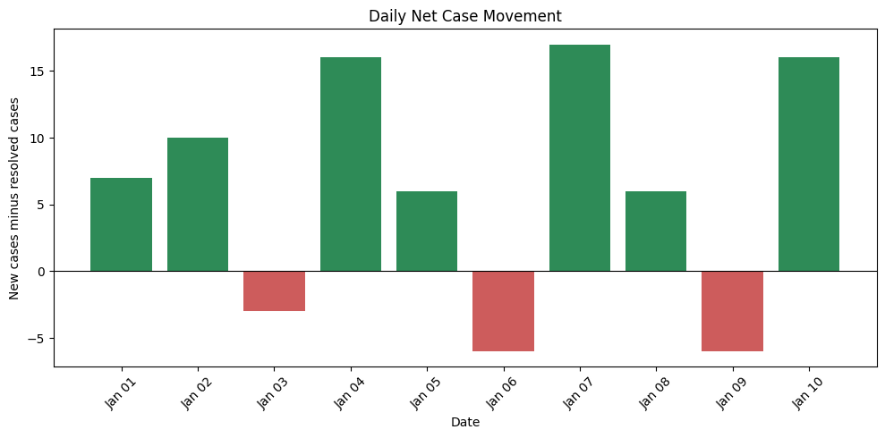
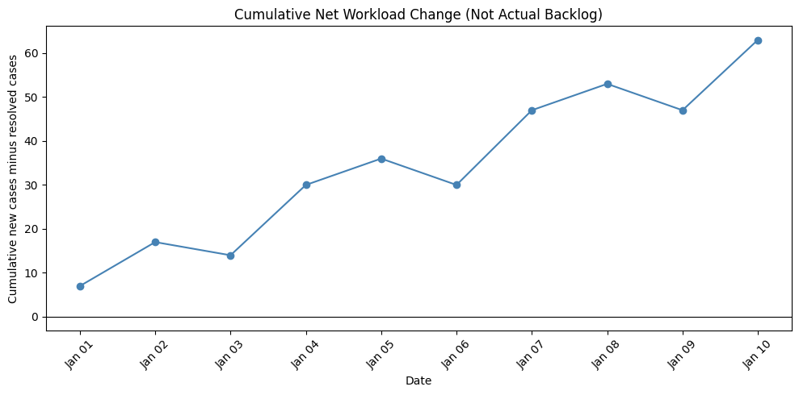
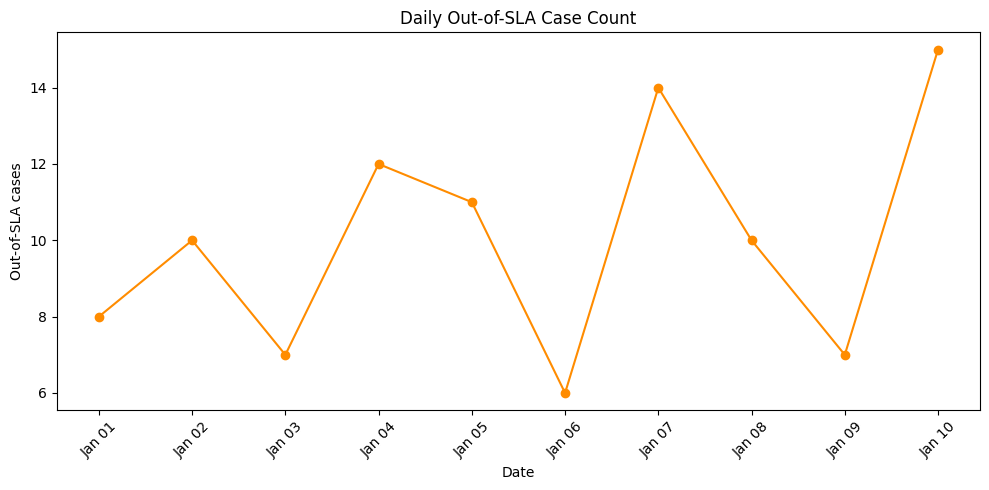

# Operational Performance Analysis Using Python

## Project Overview
This project uses fictional operational data to analyse workload, processing times and performance trends.

## Tools
- Python
- pandas
- matplotlib
- Jupyter Notebook

## Objectives
- Clean and validate data
- Identify trends and bottlenecks
- Create data visualisations
- Recommend improvements

## Status
In development
## Analysis Results

This project analyses 10 days of fictional operational data.

### Key Findings
- Total new cases: 546
- Total resolved cases: 483
- Net workload increase: 63 cases
- Throughput-to-intake ratio: 88.5%

The analysis identifies a net increase in workload over the reporting period. Further investigation into processing capacity and workflow bottlenecks would help explain the difference between incoming and resolved cases.

### Data Visualisations

#### Chart 1

#### Chart 2

#### Chart 3

### Limitations
The analysis uses fictional data covering only 10 days. Cumulative net movement is not the same as actual backlog. The sum of daily out-of-SLA counts does not necessarily represent unique cases.
