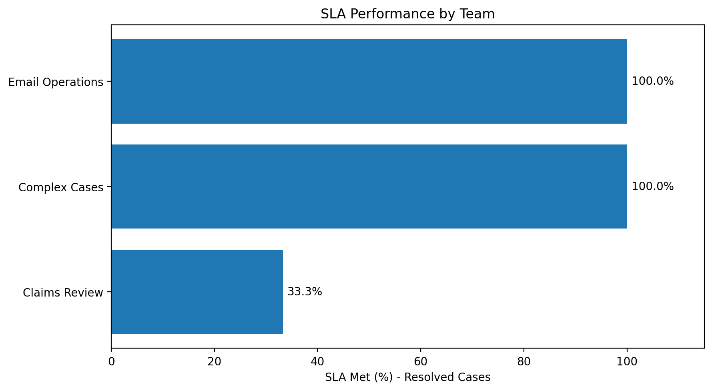
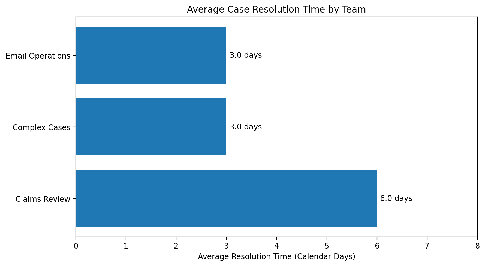

# SQL Operational Performance Analysis

## Project Overview
A SQL analysis using fictional operational datasets to explore workload, SLA performance and processing efficiency.

## Skills to Demonstrate
- SELECT, WHERE and ORDER BY
- INNER JOIN and LEFT JOIN
- GROUP BY and aggregate functions
- CASE WHEN
- Data quality checks
- KPI calculations and business insights

## Status
Completed - Portfolio demonstration using fictional data

## Analysis Results

This project analyses 12 fictional operational cases across three teams using SQL and SQLite.

### Key Findings
- Total cases: 12
- Resolved cases: 8
- Unresolved cases: 4
- Claims Review: 6.0 average resolution days and 33.3% SLA met
- Complex Cases: 3.0 average resolution days and 100% SLA met
- Email Operations: 3.0 average resolution days and 100% SLA met

### SLA Performance by Team

### Average Resolution Time by Team

### Business Insights and Recommendations
Claims Review recorded the longest average resolution time and lowest resolved-case SLA compliance in the fictional dataset. Investigate case complexity, processing delays and workload allocation before recommending operational changes.

### SQL Skills Demonstrated
- INNER JOIN
- GROUP BY and COUNT
- CASE WHEN
- SUM and AVG
- Date calculations
- KPI reporting and visualisation

### Limitations
This analysis uses only 12 fictional cases. Resolution times and SLA outcomes are calculated in calendar days, with SLA performance measured for resolved cases only. Results should not be generalised to real operations.

## Status
Completed - Portfolio demonstration using fictional data.
